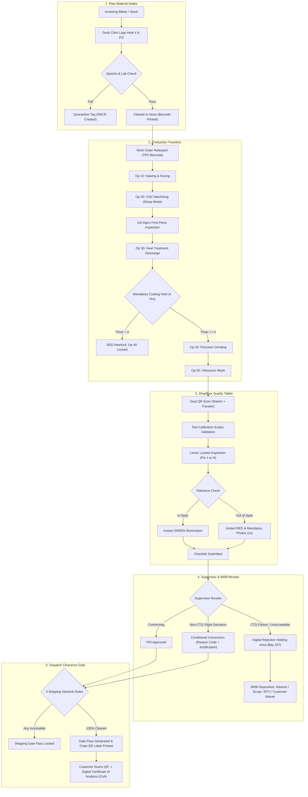

# Zapuza Factory Operations & Quality Control System

<p align="center">
  
  
  
  
</p>

---

### 🔗 Live Working Access Links

| Service | Working Direct Link | Purpose |
| :--- | :--- | :--- |
| **Main Web Application & Portal** | **[http://localhost:5000](http://localhost:5000)** | Unified production management, floor dashboard, inspector tablet, and clearance portal |
| **Vite Hot-Reload Dev Server** | **[http://localhost:5173](http://localhost:5173)** | Development interface with instant client hot module reloading |
| **System Health Check API** | **[http://localhost:5000/api/health](http://localhost:5000/api/health)** | Live system status, plant identification, and timestamp |
| **Infrastructure & Calibration Register** | **[http://localhost:5000/api/infrastructure](http://localhost:5000/api/infrastructure)** | Workstations, daily PM statuses, parts register, and gauge calibration records |
| **Job Travelers API** | **[http://localhost:5000/api/job-travelers](http://localhost:5000/api/job-travelers)** | Digital production travelers, active operation routing, and hold countdown states |
| **Shipping Interlock Status (Cleared Lot)** | **[http://localhost:5000/api/shipping/check-interlock/TRV-2026-9040](http://localhost:5000/api/shipping/check-interlock/TRV-2026-9040)** | Verifies all 3 mandatory gates passed for dispatch clearance |
| **Shipping Interlock Status (Lockout Active)** | **[http://localhost:5000/api/shipping/check-interlock/TRV-2026-9041](http://localhost:5000/api/shipping/check-interlock/TRV-2026-9041)** | Demonstrates the high-visibility gate lockout when cooling holds or ops are pending |
| **Customer Certificate of Analysis (CoA)** | **[http://localhost:5000/api/public/coa/TRV-2026-9040](http://localhost:5000/api/public/coa/TRV-2026-9040)** | Digital Birth Certificate rendered when customer scans shipping crate QR code |
| **Tamper-Proof Audit Trail API** | **[http://localhost:5000/api/audit-logs](http://localhost:5000/api/audit-logs)** | Immutable WORM log of every measurement, approval, concession, and PM check |

---

## 1. Executive Summary & Shopfloor Vision

The **Zapuza Factory Operations & Quality Control System** is an enterprise-grade digital manufacturing operating system developed by **Zapuza Technologies LLP**. Its mission is to **eliminate 100% of paper clipboards, loose inspection sheets, hand-written traveler cards, and verbal handoffs** across precision manufacturing floors.

By establishing an immediate, locked digital boundary at every workstation, the system guarantees:
- **Zero Defect Escape:** Automated locks prevent out-of-spec components from advancing to downstream operations or being packed for shipping.
- **100% Real-Time Shopfloor Visibility:** Live queues, machine cycle times, cooling hold timers, and inspection statuses accessible from any web browser.
- **Flawless Lineage & Traceability:** Every manufactured part is permanently linked to its raw material heat number, supplier mill test certificate (MTC), CNC machine ID, operator ID, tool calibration serial, and supervisor sign-off.
- **Paperless Ergonomics:** Rugged tablet workflows with large glove-friendly touch targets ($\ge 56\text{px}$), tactile audio feedback, dual QR code scanning, and offline local caching.

---

## 🏗️ Implemented Subsystems & Standard Operating Requirements

| Module | Standard Reference | Key Capabilities Implemented |
| :--- | :--- | :--- |
| **Plant Infrastructure & Calibration Locks** | **Section 2** | Machine master hierarchy, daily PM verification locks (overdue stations locked from running jobs), and tool calibration register with automated expiry lockouts (e.g., `VC-99`). |
| **Raw Material Intake & MTC Module** | **Section 3** | Dock receiving logs, Mill Test Certificate (MTC) chemistry ($\text{C}, \text{Mn}, \text{Si}, \text{Cr}, \text{Ni}$) & mechanical property cross-checking, weatherproof barcode tagging, and Supplier Non-Conformance Report (SNCR) quarantine. |
| **PDI Template Studio & Blueprint Pinning** | **Section 4** | Interactive CAD schematic canvas with color-coded inspection pins, tolerance configuration ($\pm$, max limits, visual pass/fail), tool requirements, and Critical-to-Quality (**CTQ**) priority tagging. |
| **Rugged Inspector Tablet Application** | **Section 5 & 9** | Glove-friendly touch UI, **anti-cheat 2-step QR presence rule** (station QR plate + traveler barcode), linear step-by-step locks, instant green/red tolerance feedback, mandatory defect photo capture (2 photos minimum), first-piece quality sign-offs ("Setup Mode"), and hourly periodic inspection alert siren. |
| **Shift Supervisor Approvals & Concessions** | **Section 6** | Live review queue, approval sign-off, **conditional engineering concessions** with mandatory reason codes and justifications (strictly blocked on CTQ dimensions), or quarantine to Digital Rejection Holding Bay 107. |
| **Material Review Board (MRB) Portal** | **Section 6.3** | Quarantined lot reviews executing 4 digital dispositions: Rework Order generation (Op 25 corrective machining), Scrap write-offs with cost codes, Return to Vendor (RTV), or Customer Special Concession. |
| **Process Routings & Hold Interlocks** | **Section 7 & 8** | Strict numerical sequence enforcement ($\text{Op } 10 \rightarrow \text{Op } 70$), active cycle time tracking, and **mandatory cooling/aging hold countdown timers** with automated lockout banners. |
| **Pre-Dispatch Clearance & Shipping Interlocks** | **Section 10 & 11** | Automated gatekeeping verifying the 3 mandatory rules (100% ops signed off, all hold timers fulfilled, final PDI approved). Locked gate passes with high-visibility lockout warnings if unfulfilled; unlocked digital gate pass & customer QR labels once cleared. |
| **Lineage & Traceability Engine** | **Section 7.2** | **Forward Recall Traceability:** Query Heat Lot # (e.g. `H-8042`) to locate all affected work orders, parts, and customer crates in seconds.<br>**Backward Field Traceability:** Query component serials to generate complete manufacturing birth certificates. |
| **Customer Certificate of Analysis (CoA)** | **Section 11.3** | End-customer inspection certificate accessible via crate QR code scan, detailing nominal vs actual measurements, MTC chemistry, and authorized QA director signatures. |
| **Digital Shift Handover Logbook** | **Section 12.2** | Shift handover logs tracking active jobs, parts output, scrap count, tool wear, and machine health with incoming supervisor digital signature acknowledgment. |
| **Tamper-Proof System Audit Trail** | **Section 13.3** | Immutable Write-Once Read-Many (WORM) audit log recording User ID, timestamp, IP, device serial, previous values, and new values for ISO 9001 / AS9100D compliance. |
| **Offline Storage & Caching Engine** | **Section 13.2** | Local offline caching queue when Wi-Fi drops, with automatic background synchronization upon reconnection. |

---

## 🧪 Quick Demonstration Walkthroughs

Follow these step-by-step scenarios to test the system's real-time digital boundaries and interlocks:

### 1. Test Machine PM Lock
- Open the **[Dashboard](http://localhost:5000)**.
- Note that **Precision Grinder #03** is highlighted in red with an active **"PM OVERDUE"** badge and job selection disabled.
- Click **"Sign-off PM & Unlock"**.
- *Result:* Station status turns to **VERIFIED**, zero-point is locked, and production job selection is unlocked with an immutable audit entry logged.

### 2. Test Tool Calibration Lock
- Navigate to the **[Inspector Tablet](http://localhost:5000)** view (or switch role to **QA Floor Inspector**).
- Locate the **Active Tool Serial** selector in the top bar.
- Select expired caliper **`VC-99` (Insize Digital Caliper - Expired 2026-09-30)**.
- *Result:* Screen displays an immediate alert banner: **`TOOL CALIBRATION EXPIRED - MEASUREMENT ENTRY BLOCKED`** and instructs the worker to obtain a calibrated tool from the crib.
- Switch back to **`VC-104` (Mitutoyo Caliper - Valid)** to instantly clear the error.

### 3. Test Mandatory QR Presence Scan
- On the **[Inspector Tablet](http://localhost:5000)**, observe the two-step verification workflow.
- **Step 1:** Under *Machine Frame QR Code*, click **`CNC-04` (Haas ST-20)**. The station is verified.
- **Step 2:** Under *Job Traveler Barcode*, click **`TRV-2026-9041`**.
- *Result:* The physical presence lock is satisfied and the tablet immediately transitions to the step-by-step locked inspection checklist.

### 4. Test Real-Time Green/Red Feedback & Defect Photos
- In the active inspection for **Pin 1 (Bearing Journal Outer Diameter: Nominal 45.000 mm, +0.025 / -0.010 mm)**:
  - Enter **`45.015`**: Screen illuminates in **bright GREEN** with an audible high-frequency pass chime.
  - Enter an out-of-spec number such as **`45.060`**: Screen flashes **vivid RED** with an audible warning buzzer, stating *OUT OF TOLERANCE — MANDATORY DEFECT PHOTO REQUIRED*.
  - Click **"Take Mandatory Defect Photos"**: The tablet opens the modal requiring **two distinct photos** before allowing the inspector to proceed.

### 5. Test Cooling Hold Interlock
- Navigate to **[Job Travelers & Holds](http://localhost:5000)** and select **`TRV-2026-9041`**.
- Observe that **Op 30 (Heat Treatment & Carburizing)** was completed with a **4.0-Hour Mandatory Cooling Hold** that is currently counting down.
- Attempt to click **"Advance Op 40 (Precision Grinding)"**.
- *Result:* System triggers the high-visibility red banner: **`SECTION 8.2 AUTOMATED COOLING HOLD INTERLOCK ACTIVE (X min remaining)`**, preventing the machinist from running grinding operations until thermal cooling reaches zero.

### 6. Test Shipping Gate Interlock
- Navigate to **[Dispatch Clearance](http://localhost:5000)**.
- Select traveler **`TRV-2026-9041`**: Observe that the system displays **`HIGH-VISIBILITY GATE LOCKOUT ACTIVE`** because operations and cooling holds are incomplete. The Gate Pass form is disabled.
- Select traveler **`TRV-2026-9040`** (which has 100% ops complete, cooling holds fulfilled, and PDI approved):
  - *Result:* Displays **`ALL GATES CLEARED (UNLOCKED)`**.
  - Fill in the vehicle details and click **"Issue Gate Pass & Unlock Manifest"**.
  - Click **"Print Customer Crate Label"** to view and print the weatherproof shipping QR label with digital signature.

### 7. Test Traceability & Customer CoA
- Navigate to **[Lineage & Traceability](http://localhost:5000)**:
  - **Forward Recall:** Enter Heat Lot **`H-8042`** and click *Trace Lineage*. The system lists all affected work orders, parts manufactured, and dispatched customer shipping crates.
  - **Backward Field Traceability:** Switch to Backward mode, enter **`TRV-2026-9040`**, and click *Trace Lineage*. The full manufacturing birth certificate is displayed.
  - Click **"Export Certified CoA Document"** (or view **[Sample CoA Direct Link](http://localhost:5000/api/public/coa/TRV-2026-9040)**) to open the digital Certificate of Analysis with raw material spectro chemistry, actual measurements, and authorized QA signatures.

---

## 📐 System Flowchart & State Machine



---

## 👥 Role-Based Access Control (RBAC) Matrix

| Plant User Role | Primary Responsibilities | System Permissions | Quality Safeguards Enforced |
| :--- | :--- | :--- | :--- |
| **Plant / General Manager** | Factory performance oversight, high-level plant reports | Full view across all departments, executive metrics | Past inspection values cannot be edited; all overrides logged to audit trail |
| **Quality Engineer** | Blueprint uploading, PDI template setup, tolerance definitions | Upload CAD schematics, pin inspection points, set CTQ rules | Cannot alter templates once deployed to active production |
| **Quality Manager** | Inspection template approval, engineering concessions | Approve revisions, issue official concessions | Cannot edit floor measurements; strictly blocked from issuing concessions on CTQ items |
| **Shift Supervisor** | Floor oversight, live review queue, handling rejected lots | Sign off PDI forms, manage Rejection Holding Area, clear lots | All lot approvals and quarantine actions permanently recorded with IP and timestamp |
| **QA Floor Inspector** | Conducting floor inspections on rugged tablets | Scan station/job QR codes, enter measurements, capture defect photos | Locked to physical workstation; cannot skip dimensions or edit submitted data |
| **Dispatch Clerk** | Packing verification, vehicle manifest, gate pass printing | Check shipping interlocks, generate gate passes, print crate QR labels | Cannot bypass unfulfilled quality gates or missing supervisor approvals |

---

## 🔌 Complete REST API Reference

All endpoints return JSON and are integrated with the immutable audit log:

### Infrastructure & Registry
- `GET /api/health` — System status, plant code, and ISO certification metadata.
- `GET /api/infrastructure` — Master list of factories, departments, workstations, gauges, and parts.
- `POST /api/workstations/:id/pm-check` — Sign off daily preventive maintenance and zero-point calibration.
- `GET /api/gauges/:id/validate` — Validates gauge calibration expiry status; returns lock if expired.

### Raw Material Dock Intake & MTC
- `GET /api/raw-materials` — All raw intake records and MTC certificates.
- `POST /api/raw-materials` — Log new heat intake with chemical spectro and mechanical properties.
- `POST /api/raw-materials/:id/verify` — Clear material to store or reject with Supplier Non-Conformance Report (SNCR).

### PDI Templates & CAD Pinning
- `GET /api/templates` — Inspection templates and pinned CAD schematics.
- `POST /api/templates` — Create or update template revision with coordinate pins and CTQ tags.

### Production Travelers & Hold Timers
- `GET /api/job-travelers` — Active travelers, current operations, and hold timer states.
- `POST /api/job-travelers/:id/complete-operation` — Enforce strict sequential sign-off and cooling holds.
- `POST /api/job-travelers/:id/first-piece-signoff` — Release machine station from Setup Mode.
- `POST /api/job-travelers/:id/hourly-inspection` — Log periodic frequency inspection samples.

### Tablet Floor Inspections
- `POST /api/inspections/submit` — Submit step-by-step measurements under dual QR station lock.
- `GET /api/inspections` — Historical inspection submissions.

### Supervisor Queue & MRB Dispositions
- `GET /api/supervisor/queue` — Pending inspection reviews.
- `POST /api/supervisor/decision` — Approve, grant conditional concession (non-CTQ only), or quarantine.
- `GET /api/mrb` — Quarantined lots in Digital Rejection Holding Bay 107.
- `POST /api/mrb/:id/disposition` — Execute Rework Order, Scrap Write-Off, Return to Vendor, or Customer Waiver.

### Dispatch Clearance & Customer Certificates
- `GET /api/shipping/check-interlock/:travelerId` — Verify the 3 mandatory shipping gate rules.
- `POST /api/shipping/generate-gate-pass` — Issue transport gate pass and crate QR verification label.
- `GET /api/public/coa/:travelerId` — Public/customer-facing authenticated Certificate of Analysis (CoA).

### Traceability, Handovers & Audit Logs
- `GET /api/traceability/forward/:heatNumber` — Forward supplier recall mapping.
- `GET /api/traceability/backward/:serialNumber` — Backward customer field birth certificate.
- `GET /api/shift-handovers` — Shift handover history.
- `POST /api/shift-handovers` — File shift handover form.
- `POST /api/shift-handovers/:id/acknowledge` — Digital signature acknowledgment by incoming supervisor.
- `GET /api/audit-logs` — Immutable Write-Once Read-Many (WORM) audit trail.
- `GET /api/bottlenecks` — Live shopfloor queue depth and station utilization metrics.

---

## 🛠️ Local Installation & Development

### 1. Prerequisites
- **Node.js** $\ge 18.0.0$ (Tested on Node v24)
- **npm** $\ge 9.0.0$

### 2. Setup & Installation
```bash
# Clone or navigate to the repository
cd Zapuza

# Install backend dependencies
npm install

# Install frontend dependencies
cd client
npm install
cd ..
```

### 3. Running Both Servers
```bash
# Start Backend API & Production Server (Port 5000)
npm run server

# In a second terminal, start the Vite Dev Server (Port 5173)
npm run client
```

Or run the full production application directly on **`http://localhost:5000`**:
```bash
node server/server.js
```

---

<p align="center">
  <b>Zapuza Technologies LLP</b> • Complete Shopfloor Quality Assurance, In-Process Tracking & Final Dispatch Clearance System<br>
  <i>Confidential & Proprietary Standard Operating Specification v5.0</i>
</p>
